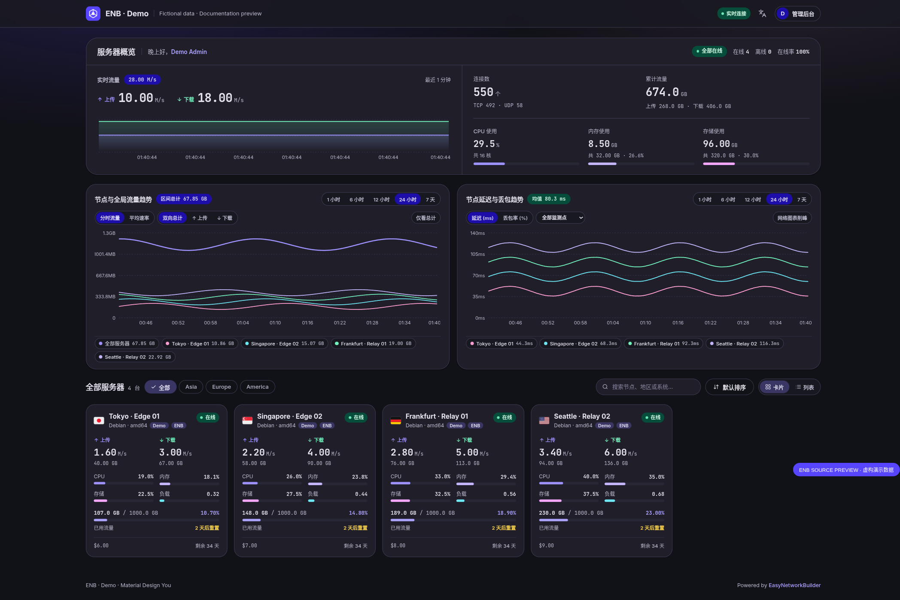
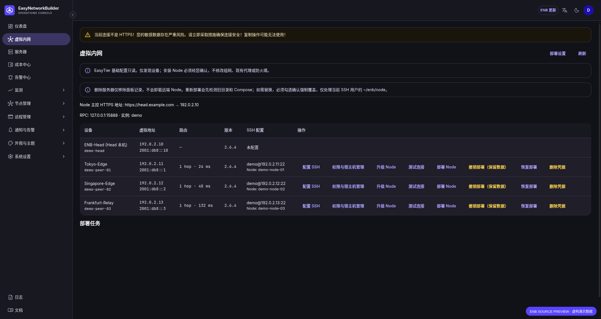

# ENB · Easy Network Builder

**自托管的服务器监控、代理节点管理与虚拟内网运维面板。**

ENB 基于 [Lite-Plus](https://github.com/nuomiiiii/Lite-Plus) 及其配套 Web、Agent 二次开发，将服务器状态、Xray / sing-box、用户订阅、EasyTier 设备与受控宿主机操作集中到一个管理入口。适合管理自有或已获授权的多台服务器，不只是一个展示在线状态的探针。

[项目特点](#项目特点) · [界面预览](#界面预览) · [功能概览](#功能概览) · [快速开始](#快速开始) · [部署与更新](#部署与更新) · [开发](#开发) · [上游与许可证](#上游与许可证)

> [!IMPORTANT]
> 本文介绍**当前源码**的能力，不代表全部功能已包含在稳定镜像中或完成生产验收。当前已发布 **Head 0.0.4 / Node 0.0.1**，官方镜像为 [`docker.io/nodokaqwq/enb`](https://hub.docker.com/r/nodokaqwq/enb)。平台、兼容来源和测试边界以 [发布目录](releases/README.md) 及各版本说明为准。

## 项目特点

### 从监控延伸到节点管理

在 CPU、内存、磁盘、流量和网络质量监测之外，统一管理代理入站、出站、路由、转发、用户、套餐、证书与订阅。服务器监控、宿主机流量和代理用户用量各有对应视图，不混为同一份计量数据。

### 基于已有 EasyTier 网络发现和部署

读取现有 EasyTier 实例中的设备、虚拟地址、跳数和路径时延；为设备配置可信 SSH 连接后，可从网页部署受管 Node、查看任务状态、停止并保留数据、恢复原部署。**不创建或修改 EasyTier 组网**，也不自动接管已有代理。

### 区分 Node 与宿主机的权限

Node 内的终端、文件、命令、MCP、防火墙和服务保护分别授权；宿主机 SSH 终端、SFTP、命令以及指定 Compose 项目另行管理。敏感入口要求管理员二次认证，SSH 使用固定主机指纹校验，保存的凭据加密且不回显。

### 可追溯的版本与更新流程

Head 与 Node 独立发布，从受信 Git 清单发现版本，按不可变镜像 digest 部署。Head 更新由宿主机独立更新器执行，无需向 Head 容器开放 Docker Socket；通过来源版本检查、停机快照、就绪校验和失败恢复控制升级过程。

### Material Design 3 界面

管理后台采用 Material You 风格的明暗配色、统一组件与图表样式，并使用 Inter、JetBrains Mono 和 Material Symbols。公共监控页与管理后台分离，内置 **ENB Material You** 主题，支持节点卡片、列表、流量与网络质量趋势以及节点详情。

### 与 Lite / Lite-Plus 的关系

ENB 的直接开发底座是 **Lite-Plus**，不是从零实现的监控系统。监控、双内核管理、订阅、账单、告警和部分远程能力继承自上游；EasyTier 接入、SSH 受管部署、分层权限、宿主机管理、ENB 发布更新流程和视觉改造是本项目重点扩展。源码保留 `lite-plus*` 目录名称，以便追溯来源。

## 界面预览

以下为本地隔离环境中使用**虚构数据**渲染的界面示例，非生产截图；设备名、账号、流量与延迟均为演示值，地址使用文档保留网段，域名使用 `example.com`。图片展示当前源码界面，不作为实际部署、连接或权限生效的验收证明。

### 公共监控大屏 · ENB Material You



### 管理后台 · EasyTier 虚拟内网



截图说明见 [图片说明](docs/images/README.md)。

## 功能概览

### 监控与网络质量

| 模块 | 已实现能力 |
| --- | --- |
| 服务器监控 | CPU、内存、磁盘、负载、网络速率、累计流量、连接数、进程数、运行时间与在线状态；采集网卡等参数可配置 |
| 仪表盘 | 模块开关与排序、实时与历史曲线、流量排行、每日明细及续费日历 |
| 延迟监测 | IPv4 / IPv6 目标探测、延迟与丢包历史、网络质量告警 |
| 回程监测 | 运营商与线路识别、预期线路对比、状态与历史事件；当前源码支持按服务器聚合多个目标，并自动关联延迟监测 |
| 成本中心 | 多币种费用汇总、资费与计费周期、到期提醒、续费和附加费用记录 |
| 通知告警 | 离线、负载、延迟丢包和流量告警，多渠道分发、同类内容汇总及流量报告 |
| 公共主题 | 与管理 UI 独立，支持公开或私有站点、明暗模式、分组筛选、搜索与节点详情 |

### 代理内核与订阅

| 模块 | 已实现能力 |
| --- | --- |
| 双内核 | 集成 Xray / sing-box，管理内核配置并下发到配套 Node |
| 入站与出站 | VLESS、VMess、Trojan、Shadowsocks、HTTP、Hysteria2、TUIC、AnyTLS 等；按协议与内核支持 TLS / Reality；可从分享链接或已有入站导入出站 |
| 路由与转发 | 配置路由规则，连接线路机与落地入站，多条线路可复用落地 |
| 用户与套餐 | 用户启停、额度、有效期、套餐分配与用量统计 |
| 证书 | 代理入站相关证书管理与配置关联 |
| 订阅 | 节点列表及 Clash / Mihomo、sing-box、Loon、Surge 等客户端模板；按系统、套餐和订阅绑定模板，支持客户端识别、预览与二维码 |

协议支持不代表所有客户端、传输组合或版本均兼容。Hysteria2、TUIC、AnyTLS 使用 sing-box；实际连接应按目标客户端验收。订阅模板与计量说明见 [订阅文档](lite-plus/docs/subscription-templates.md)。

### 虚拟内网与受控运维

| 模块 | 已实现能力 |
| --- | --- |
| 设备发现 | 从已有 EasyTier RPC 读取设备名称、虚拟 IPv4 / IPv6、版本、跳数与路径时延，仅输出白名单字段 |
| SSH 接入 | 密码或密钥认证、独立核实主机指纹、连接测试，以及部署所需的可选 sudo 配置 |
| Node 生命周期 | 部署到 SSH 登录用户的 `~/enb/node`；任务状态、冲突检测、显式覆盖、撤销部署并保留数据、恢复原 Compose |
| 镜像获取 | 从稳定清单选择兼容 Node，先检查缓存、限时拉取；失败后可经已授权设备 SSH 中转，校验镜像身份后运行 |
| Node 权限 | 终端、文件、命令、MCP、防火墙、服务保护独立白名单；支持为受管 Node 应用权限并重建容器 |
| 宿主机管理 | SSH 网页终端、SFTP 文件和限时命令；受管 Node Docker 状态、日志与启停；其他明确授权 Compose 项目的状态、日志与启停 |
| 防火墙与服务保护 | 主机入站规则、禁止 ping、默认拒绝，以及按策略观察或封禁来源 IP；依赖 Node 功能开关、系统权限和相应后端 |
| 远程与 MCP | 继承上游终端、文件、任务及 MCP 授权能力；需满足站点、Node 本地开关与对应权限，不默认获得任意宿主机权限 |
| 账号安全 | 管理员登录、双因素认证、通行密钥、会话管理及敏感操作重新验证 |

> [!WARNING]
> 权限开关是**功能入口授权，不是操作系统沙箱**。终端或命令具有 SSH / Agent 运行账号本身的权限；Docker 访问通常等同 root 权限。请只在自有或已获授权的设备上使用，并启用 HTTPS 与双因素认证。

## 架构

```text
浏览器
  ├─ 公共监控主题
  └─ 管理后台
          │ HTTPS / HTTP API / JSON-RPC / WebSocket
          ▼
       Head（Go）
          ├─ 数据、监控、用户、套餐与订阅
          ├─ 已有 EasyTier RPC → 发现设备（不修改组网）
          ├─ SSH / SFTP → 已授权宿主机与受管 Compose
          └─ Unix Socket → 宿主机独立 Head 更新器
          ▲
          │ Node 主动连接 / 状态上报 / 控制与回执
       Node（Go）
          ├─ 系统指标与网络探测
          ├─ Xray / sing-box
          └─ 经授权的远程操作与防护
```

EasyTier 是可选接入能力，不是所有监控功能的前置依赖。使用虚拟内网部署流程时，Head 必须能访问已有 RPC，目标设备已加入该网络，并具备可达的 SSH 和 Docker Compose 环境。

## 快速开始

### 环境要求

- 官方稳定镜像目前仅发布 **Linux / amd64**；上游支持的平台不等于 ENB 已发布的平台。
- 运行 Head 需要 Docker；受管 Node 部署需要目标机预先安装 Docker 和 Compose v2。
- 使用 EasyTier 集成前，应先由管理员完成组网、RPC 访问控制及 Head 到 RPC 的连通性配置。
- 正式访问需配置可信 HTTPS；内网映射不替代 TLS 证书和 DNS / 反向代理配置。

### 启动一个基础 Head

以下命令在仓库根目录执行，仅启动基础面板，**不安装 EasyTier 或宿主更新器，也不修改现有服务**。需要 Git、Python 3 和 Docker；已有实例不要用此命令另建或覆盖数据目录。

```sh
git clone https://github.com/NodokaQwQ/EasyNetworkBuilder.git
cd EasyNetworkBuilder

# 从已检出的稳定清单读取精确镜像 digest，不运行可变 latest。
export ENB_HEAD_IMAGE="$(python3 -c 'import json; print(json.load(open("releases/head-stable.json"))["releases"][0]["image"])')"

mkdir -p data
chmod 700 data
docker run -d \
  --name enb-head \
  --restart unless-stopped \
  --platform linux/amd64 \
  -p 127.0.0.1:28777:28777 \
  -v "$(pwd)/data:/app/data" \
  "$ENB_HEAD_IMAGE" \
  /app/Lite server --listen 0.0.0.0:28777
```

从宿主机访问 `http://127.0.0.1:28777`，按首次安装向导初始化，再进入 `/admin`。远程初始化应使用 SSH 隧道；对外服务时，由管理员配置 HTTPS 反向代理。此示例只绑定回环地址，不应直接改为公网明文访问。

`data/` 保存数据库、实例密钥及其他持久数据。备份与恢复应保留完整目录，不要只复制主 SQLite 文件，也不要将它提交到仓库。

### 接入受管 Node

1. 按 [EasyTier 接入说明](deploy/easytier/README.md) 配置已有 RPC 的访问方式。
2. 在「虚拟内网 → 部署设置」填写主控 HTTPS 地址、可选虚拟 IP 映射及 EasyTier RPC / 实例名。
3. 为目标设备配置 SSH，**从独立可信渠道核实主机指纹**，再保存凭据并测试连接。
4. 在「权限与宿主机管理」只授权所需功能，检查目标端口与部署条件后确认部署。
5. 等待任务完成和新的 Node 连接，核对采集、内核配置及实际业务；不要仅凭容器启动判定全部可用。

该流程不会替你安装 Docker、修改 sudoers、开放防火墙或迁移旧代理。仓库子目录中的上游安装脚本和示例可能仍指向 Lite-Plus 发布源，**不能当作 ENB 官方安装或升级入口**。

## 部署与更新

| 场景 | 文档 |
| --- | --- |
| EasyTier 接入、SSH 部署、暂停 / 恢复与流量口径 | [接入与受管部署](deploy/easytier/README.md) |
| Node 与宿主机授权、Compose 白名单及限制 | [权限边界](deploy/easytier/PERMISSIONS.md) |
| Head 独立更新器、首次接入、数据布局与失败恢复 | [Head 更新器](deploy/updater/README.md) |
| 受管 Node 升级、内核数据快照与回滚 | [Node 更新](deploy/updater/NODE.md) |
| 稳定清单、构建发布、兼容来源与供应链边界 | [版本目录与发布流程](releases/README.md) |
| 当前 Head 发布范围及未验收项目 | [Head 0.0.4](releases/0.0.4.md) |

- 更新由管理员手动确认；版本检查不等于无人值守自动升级，不通过移动 `latest` 更新现有服务。
- Head 更新器需人工安装，仅支持符合要求的单实例、本地 SQLite 和持久数据 bind 布局；不向 Head 挂载 Docker Socket。
- 升级会短暂中断服务；失败恢复停机快照可能丢失升级期间的新写入，不是零停机更新。
- 停止并保留数据后，恢复使用原 Compose、镜像和数据，不自动套用新部署模板。**强制覆盖不是无损升级。**
- 不承诺从原 Lite、Lite-Plus 或任意自定义布局直接无损迁移；只开放清单明确列出的升级来源。

### 配置入口

| 配置 | 位置 |
| --- | --- |
| 新 Node 的主控 HTTPS 地址与可选虚拟 IP | 虚拟内网 → 部署设置 |
| 已有 EasyTier RPC 与实例名 | 虚拟内网 → 部署设置；留空使用环境配置 |
| SSH 账号、端口、凭据、指纹及部署 sudo | 虚拟内网 → 对应设备 SSH 配置 |
| Node 权限、宿主机入口与 Compose 目录授权 | 对应设备 → 权限与宿主机管理 |
| 代理入站、出站、路由、用户与订阅 | 节点管理对应页面 |
| Head 监听、持久数据、网络模式及 CLI 路径 | 宿主机 Compose / 环境变量 |
| 更新器路径、Socket 与 systemd | root 控制的宿主机配置 |

## 当前边界

- **源码与发行版有差异**：后台 MD3 改造、按服务器多目标回程、节点列表计费窗口等后续改动不能按 Head 0.0.4 的验证记录推定已发布；以实际版本说明为准。
- **计量不是同一口径**：新受管 Node 使用 host 网络，并选择可识别的宿主出口网卡统计整机流量，包括其他程序和容器；用户 / 套餐用量来自内核。多出口、bond、VLAN、隧道或策略路由需要人工核定，历史不会自动补算，不承诺与云厂商账单精确一致。
- **host 网络直接占宿主机端口**：旧 bridge 部署不自动迁移，应保留 Token、快照和配置，在维护窗口检查双栈监听、端口冲突和回退方案。
- **部分端到端验收仍缺失**：0.0.4 的跨节点镜像流式中转、完整 Mihomo 订阅真实连接尚未独立验收通过，不能只凭单元测试或演示图认定可用。
- **不宣称已完成独立安全审计**：HTTPS 与 digest 校验不等于发布者签名，当前发布目录尚无签名验证；请保护清单控制权、SSH 凭据、Agent Token 和实例密钥。

## 开发

```text
lite-plus/          Head 后端（Go、Gin、GORM）
lite-plus-web/      管理前端（React、TypeScript、MUI、Vite）
lite-plus-agent/    Node 与 Xray / sing-box 集成
enb-theme/         ENB Material You 公共监控主题
deploy/easytier/   接入、受管部署、镜像构建与验收工具
deploy/updater/    独立 Head 更新器与 Node 更新说明
releases/         Head / Node 稳定版本清单与发布说明
scripts/          ENB 版本验证、构建与发布工具
docs/images/      仅含虚构数据的文档图片
```

三个 `lite-plus*` 目录均为根仓库管理的普通源码目录，并非子模块。构建以各目录的依赖文件和 Dockerfile 为准：Head 的 `go.mod` 要求 Go 1.26.10，Node 要求 Go 1.27；当前镜像使用 Go 1.27.3 与 Node.js 26。部分前端测试依赖较新的 Node.js API，建议使用镜像一致的工具链。

在仓库根目录验证发布清单与更新器：

```sh
python3 scripts/release.py validate
python3 -m unittest discover -s deploy/updater -p 'test_*.py'
```

在 `lite-plus-web/` 中验证管理前端：

```sh
npm ci
npm test
npm run build
```

Head、Node 的 Go 测试应在各自目录运行，并对相关变更执行竞态检查与 `go vet`；Node 的内核构建需保留对应 build tags。涉及外网 GeoIP、系统防火墙、Docker 或远程设备的测试有环境依赖，不应将跳过或模拟测试解释为真实业务验收。Head 镜像构建会嵌入管理前端和公共主题，详见 [发布流程](releases/README.md)。

## 上游与许可证

感谢 [Lite](https://github.com/nuomiiiii/Lite)、[Lite-Plus](https://github.com/nuomiiiii/Lite-Plus)、[Lite-Plus-web](https://github.com/nuomiiiii/Lite-Plus-web)、[Lite-Plus-agent](https://github.com/nuomiiiii/Lite-Plus-agent)，以及 Xray、sing-box、EasyTier 和其他开源依赖。

导入基线及来源见 [UPSTREAM.md](UPSTREAM.md)。各组件和依赖保留其各自许可证与版权义务：Head 原许可证见 [lite-plus/LICENSE](lite-plus/LICENSE)，Agent 原许可证见 [lite-plus-agent/LICENSE](lite-plus-agent/LICENSE)。**当前统一许可证整理与发行审查尚未完成，不应将整个仓库概括为已完成统一 MIT 或 GPLv3 授权。**

请勿提交真实域名、服务器地址、凭据、订阅 Token、私钥或运行数据。当前文档脱敏不等于清除 Git 历史，历史内容仍需另行审查。
